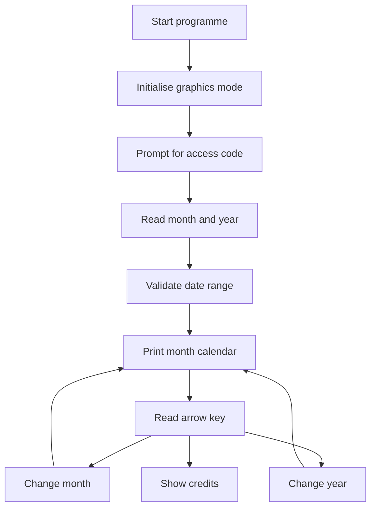

# GraphicalCalendar

A DOS-style C calendar programme that renders a monthly calendar with graphics borders, keyboard navigation and rotating quotes.


## Overview

`Afinal.C` is a single C source file for an interactive calendar application. It uses `graphics.h`, `conio.h`, `initgraph`, `getch`, `clrscr`, `random` and BGI drawing functions, so it targets a Turbo C or Borland-style DOS graphics environment rather than standard modern C.

## Programme flow



## Features visible in the code

- Prompts for a four-character access code before showing the calendar.
- Accepts a month and year in `MM YYYY` format.
- Validates the month and year before rendering.
- Calculates the first weekday using a month offset table and leap-year logic.
- Prints a Sunday to Saturday calendar layout.
- Shows a randomly selected quote after the calendar.
- Draws a changing rectangular border with BGI graphics functions.
- Uses arrow keys to move by month or year.
- Shows a credits screen when navigation exits.

## File structure

| File | Purpose |
| --- | --- |
| `Afinal.C` | Complete calendar source code. |
| `README.md` | Project documentation. |

## Compile and run

This code is best compiled in a Turbo C or Borland C++ environment configured for BGI graphics.

Typical legacy workflow:

```text
Open Afinal.C in Turbo C or Borland C++
Configure the BGI path for graphics.h
Compile and run from the IDE
```

On a modern machine, use DOSBox with Turbo C or adapt the code to a contemporary graphics library. A normal GCC or Clang build will not work without replacements for `graphics.h`, `conio.h` and the BGI functions.

## Project date and contributors

- Repository created: 2017.
- GitHub contributor data lists `rishabhjain9196`.
- The source credits Aditya Shukla, Himanshu Singh and Rishabh Jain.
